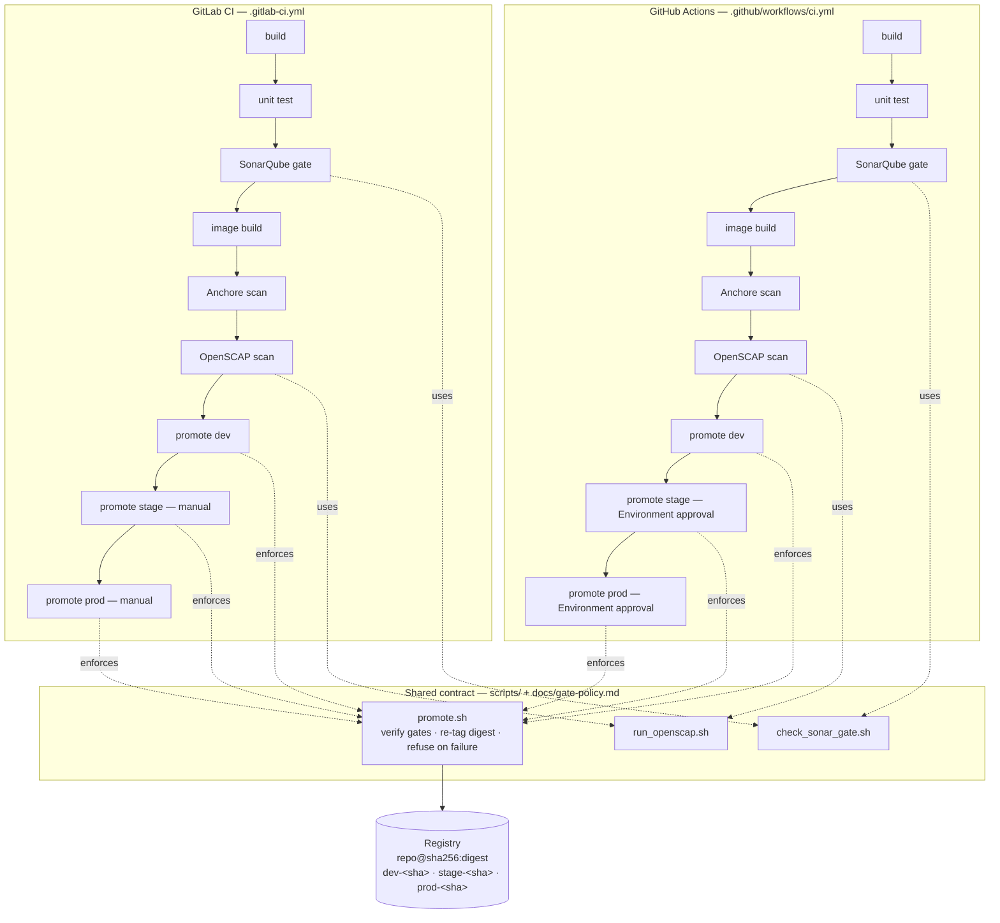

# Secure CI/CD Pipeline — Gates, Scans, and Digest Promotion

A reference implementation of a security-gated delivery pipeline:
code is built **once**, passed through unit tests, a SonarQube quality
gate, an Anchore container scan, and an OpenSCAP compliance scan —
and only then **promoted** across `dev → stage → prod` by re-tagging
the same immutable image digest, with a human approving stage and
prod.

The same flow is implemented twice — GitLab CI
([`.gitlab-ci.yml`](.gitlab-ci.yml)) and GitHub Actions
([`.github/workflows/ci.yml`](.github/workflows/ci.yml)) — because
real platform work rarely gets to pick just one CI system. Both
implementations converge on one shared promotion contract
([`scripts/promote.sh`](scripts/promote.sh)), which is the actual
subject of this repository. A small standard-library Python service
([`app/`](app/)) exists so the pipeline has something real to build,
test, scan, and promote.

> **Framing:** this is a reference implementation of production
> patterns — pipeline architecture, gate policy, and promotion
> discipline — built to be read, run, and adapted. It is not a claim
> about any specific employer's systems.

## The problem

Two failure modes show up again and again in delivery pipelines:

1. **Security checks that advise instead of decide.** A scanner runs,
   prints findings, and the pipeline ships anyway. Findings accumulate
   in reports nobody is accountable for, and "we scan in CI" becomes
   compliance theater.
2. **Rebuilding between environments.** Dev gets one artifact, stage
   gets a rebuild, prod gets another. Now the thing that was tested
   is not the thing that shipped, and every environment discrepancy
   is undebuggable — was it the code, the build, or the environment?

This pipeline is designed against both: every check is a **gate**
that can fail the pipeline, and environments receive the **same
digest**, promoted — never rebuilt.

## Architecture



### Stage-for-stage mapping

| # | Stage | GitLab CI job | GitHub Actions job | Gate |
| - | ----- | ------------- | ------------------ | ---- |
| 1 | Build | `build` | `build` | Compile/install must succeed |
| 2 | Unit test | `unit-test` | `test` | Tests pass, coverage ≥ 80% of `app/` |
| 3 | Quality gate | `sonarqube-gate` | `quality` | SonarQube gate status = `OK` |
| 4 | Image build | `image-build` | `image` | Built once, tagged `sha-<sha>`, digest captured |
| 5 | Image scan | `anchore-scan` | `scan` | No fixable High/Critical CVEs (Grype / Anchore scan action) |
| 6 | Compliance scan | `openscap-scan` | `compliance` | No failed applicable OpenSCAP rules |
| 7 | Promote → dev | `promote-dev` | `promote-dev` | Automatic, after all gates |
| 8 | Promote → stage | `promote-stage` (`when: manual`) | `promote-stage` (`stage` Environment) | Human approval |
| 9 | Promote → prod | `promote-prod` (`when: manual`) | `promote-prod` (`production` Environment) | Human approval |

Each gate job records its verdict (`SONAR_GATE`, `ANCHORE_SCAN`,
`OPENSCAP_SCAN` = `PASS`/`FAIL`) in a small evidence file that travels
with the run as a pipeline artifact. Promotion reads the assembled
`gate-status.env` — see the contract below. Full rationale for every
threshold is in [`docs/gate-policy.md`](docs/gate-policy.md).

## The promotion contract

Promotion is the part most pipelines get casually wrong, so it lives
in one script ([`scripts/promote.sh`](scripts/promote.sh)) that both
CI systems call, instead of being re-implemented in two YAML dialects:

1. **Digest-pinned source.** The script refuses any source reference
   that is not `repo@sha256:…`. A mutable tag could resolve to
   different bits than the ones that were scanned.
2. **Evidence required.** All three gates must have recorded `PASS`.
   A missing gate file is a refusal, not a pass — absence of evidence
   is treated as failure everywhere in this design.
3. **Re-tag, never rebuild.** Promotion uses
   `docker buildx imagetools create` to point the environment tag
   (`dev-<sha>`, `stage-<sha>`, `prod-<sha>`) at the existing digest,
   registry-side. The digest running in prod is bit-for-bit the digest
   that passed the gates in dev.
4. **Approval is a precondition, not a comment.** For stage/prod the
   script requires `PROMOTE_APPROVED=true`, which is set only inside
   the manually approved job (GitLab `when: manual`; GitHub
   Environment required reviewers). Invoking the script directly,
   without going through the approved job, refuses.

## Key decisions and tradeoffs

- **Gates fail closed, including on infrastructure errors.** If
  SonarQube times out or the scanner errors, the pipeline goes red.
  A green pipeline that silently stopped scanning is worse than a red
  one — it's a supply-chain incident wearing a checkmark.
- **Anchore gates on *fixable* High/Critical only.** An unfixable CVE
  has no remediation; blocking delivery on it forever teaches teams
  to ignore the gate. Fixable findings are reported *and* gated;
  unfixable findings are reported and tracked. The SBOM (SPDX) of the
  exact digest is published every run as evidence.
- **SonarQube gates on new-code conditions.** The bar ratchets:
  a change cannot add bugs, vulnerabilities, or unreviewed hotspots,
  even in a codebase carrying legacy findings.
- **OpenSCAP scope is stated honestly.** `oscap-docker` evaluates the
  image against the profile; host/daemon rules report as
  not-applicable and belong to host configuration management. The
  full XCCDF results and HTML report are kept as artifacts — the
  gate is a summary of evidence, not a replacement for it.
  ([`scripts/run_openscap.sh`](scripts/run_openscap.sh) documents
  this in detail.)
- **The sample service has zero runtime dependencies.** Stdlib-only
  Python keeps the image surface at "base image + this code," which
  makes the scans fast and their results legible. The pipeline is
  unchanged if the service grows real dependencies — they'd be pinned
  with hashes in `requirements.txt`.
- **Platform-native approvals, shared enforcement.** GitLab manual
  jobs and GitHub Environments are genuinely different mechanisms;
  each pipeline uses its platform's native one, and the shared script
  enforces the technical preconditions identically in both.

## What this demonstrates

- Secure CI/CD design in both GitLab CI and GitHub Actions, held to
  one contract instead of drifting into two dialects of "secure-ish"
- Quality gating with SonarQube (scan submission vs. asynchronous
  gate verdict — and why you must wait for the second one)
- Container supply-chain controls: digest pinning, SBOM generation,
  Anchore/Grype vulnerability gating by severity *and* fixability
- Compliance scanning with OpenSCAP in a pipeline, including an
  honest treatment of what image-level scanning can and cannot prove
- Artifact promotion architecture: build once, promote the digest,
  manual accountability for stage/prod
- CI variable governance: masked + protected secrets, placeholders
  only in the repo, registry credentials scoped to the jobs that
  need them

## Run it

### The service, locally

```bash
python -m app.main            # serves on :8080
curl localhost:8080/health
curl "localhost:8080/api/v1/greet?name=Pipeline"
# or: docker compose up app
```

### The tests

```bash
python -m unittest discover -s tests -v   # zero dependencies
pip install -r requirements-dev.txt && pytest -q   # the CI route
```

### The promotion script, in dry-run

```bash
cat > gate-status.env <<'EOF'
SONAR_GATE=PASS
ANCHORE_SCAN=PASS
OPENSCAP_SCAN=PASS
EOF

DRY_RUN=true \
IMAGE_REF=registry.example.internal/team/sample-service@sha256:abc123 \
IMAGE_TAG=sha-abc1234 \
TARGET_ENV=stage \
PROMOTE_APPROVED=true \
./scripts/promote.sh
# Remove PROMOTE_APPROVED and watch it refuse — that refusal is the point.
```

### The pipelines

1. Create the CI variables listed in [`.env.example`](.env.example)
   in your CI system — secrets masked (and protected, where the
   platform supports it). Hostnames in this repo are placeholders.
2. GitLab: the pipeline runs on merge requests and the default
   branch; stage/prod promotions appear as manual jobs.
3. GitHub: add required reviewers to the `stage` and `production`
   Environments, then push to `main`. For an out-of-band promotion
   of an existing digest, dispatch
   [`.github/workflows/promote.yml`](.github/workflows/promote.yml)
   with the digest and the CI run ID that gated it.

## Repository layout

```
app/                  sample service (stdlib-only Python)
tests/                unit tests (unittest + pytest compatible)
scripts/
  promote.sh          the promotion contract, enforced
  check_sonar_gate.sh SonarQube gate polling + verdict recording
  run_openscap.sh     container-based OpenSCAP scan of the image
docs/gate-policy.md   what fails a build, and why
.gitlab-ci.yml        GitLab CI implementation
.github/workflows/    GitHub Actions implementations (ci.yml, promote.yml)
Dockerfile            multi-stage, non-root, slim base
docker-compose.yml    optional local stack (app; SonarQube behind a profile)
```

## Interview notes

*Talk-track for walking a reviewer through this repository.*

- **Where gates belong, and why there:** as early as the check can
  run, but no earlier than it can be *accurate*. Unit tests and the
  SonarQube gate run on source, before the image exists — cheap and
  fast. Anchore and OpenSCAP need the built artifact, so they run on
  the digest, after the build and before any environment sees it.
  Putting an image scan before the build is impossible; putting it
  after promotion is pointless.
- **The scanner ≠ the gate.** Submitting a SonarQube analysis is not
  the same as passing the quality gate — the verdict is computed
  asynchronously, and pipelines that don't wait for it are decorating,
  not gating. Same idea with Anchore: producing a report is not a
  control; failing the pipeline on a stated threshold is.
- **Promote digests, never rebuild.** The moment an environment gets
  a rebuild, "tested" and "shipped" become two different artifacts
  and every comparison across environments is suspect. Re-tagging a
  digest registry-side is also faster and cheaper than rebuilding.
- **What I refuse to automate: the prod approval.** Everything up to
  that click is automated precisely so the human decision is the only
  human step — and so the human is approving something with complete,
  attached evidence: test results, gate verdicts, SBOM, compliance
  report, and a digest that provably matches what passed. Automating
  the approval itself would remove accountability without removing
  risk.
- **Fail-closed is a deliberate annoyance.** Yes, a scanner outage
  blocks deploys. That's the trade I choose: a visible, fixable
  outage over an invisible gap in scanning that ships unnoticed.
- **Honest limits:** the OpenSCAP stage evaluates the image, not the
  host; runtime security (admission control, network policy,
  secrets management in the cluster) is a different layer — in my
  platform work that layer is policy-as-code and GitOps-managed
  configuration, which this pipeline feeds but does not replace.

## License

MIT — see [LICENSE](LICENSE).
